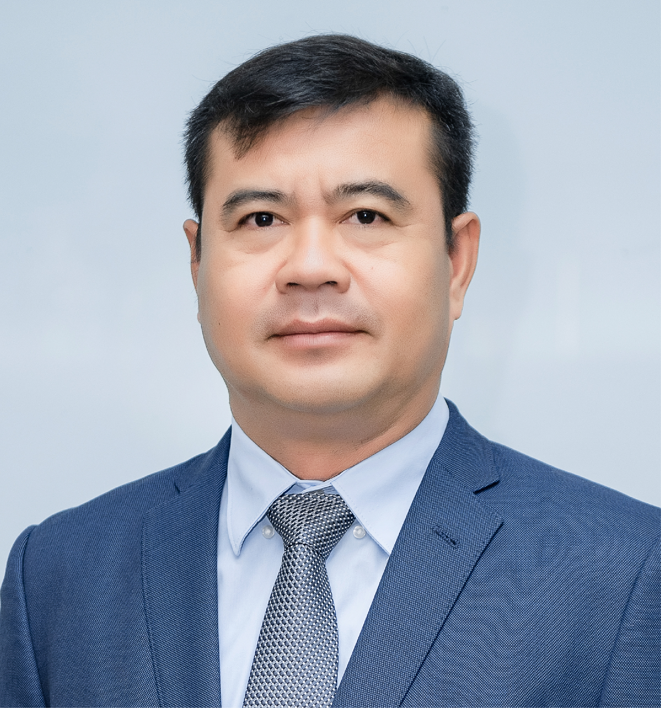
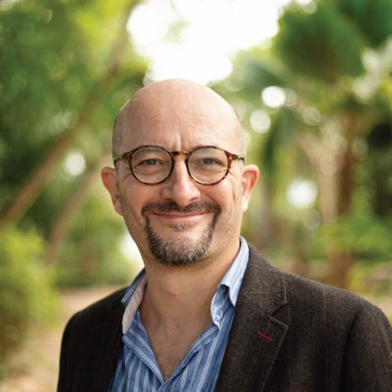
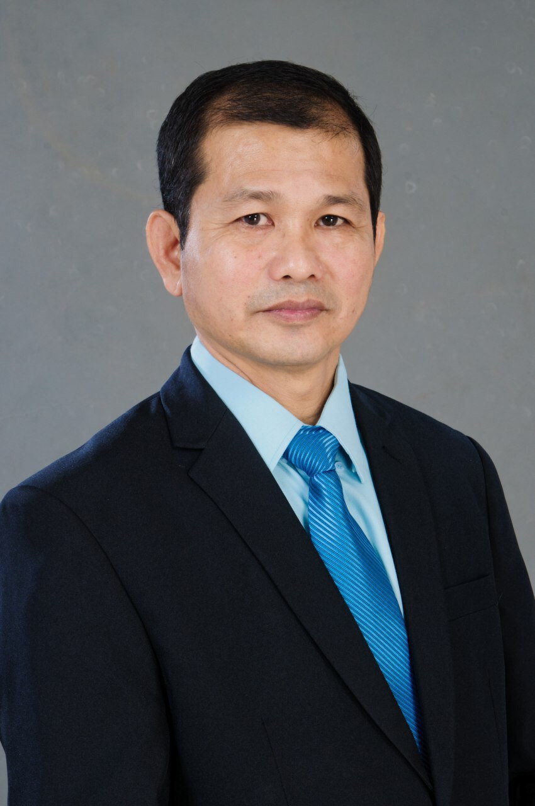
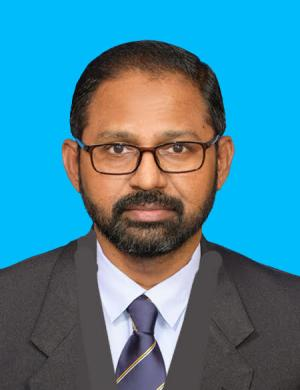
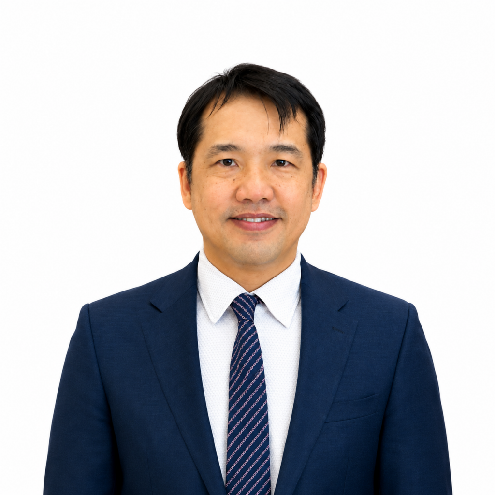
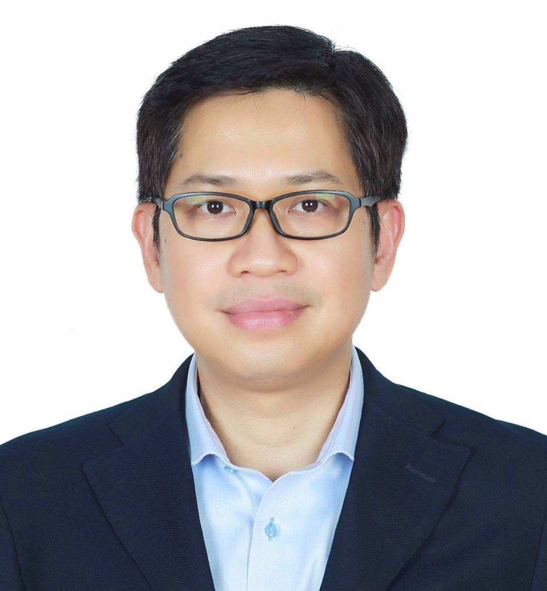
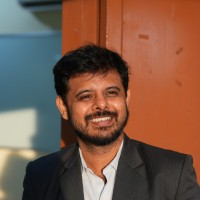
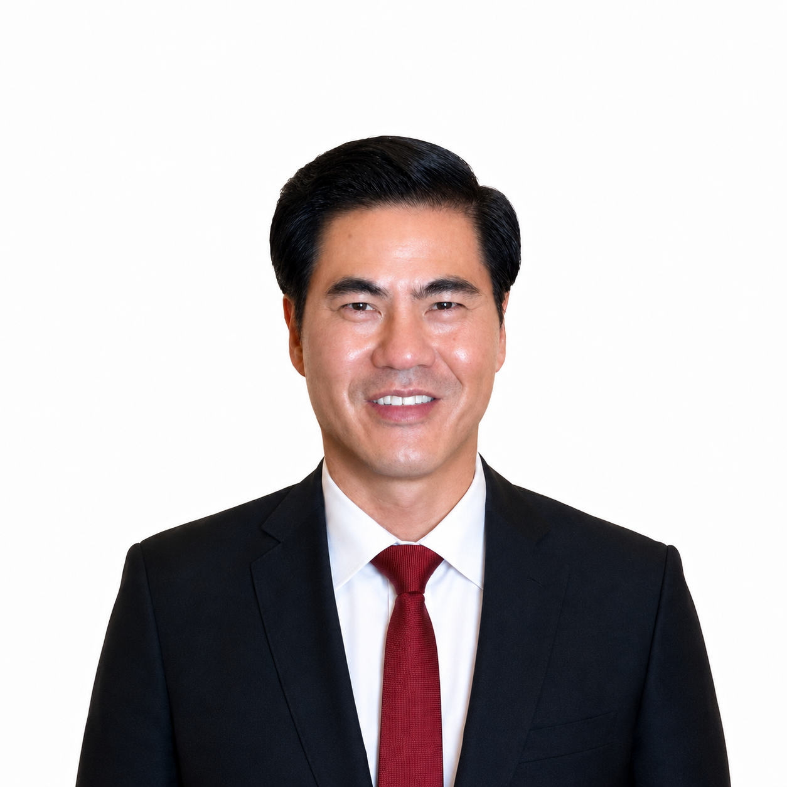

Opening remarks, special lecture, panel discussants, and plenary speakers at SAERD 2026. Panel A speakers will be announced.

```{=html}
<div class="speaker-grid">
<article class="speaker-card" id="kao-thach"><div class="speaker-photo"></div><div class="speaker-info"><h3>H.E. Dr. Kao Thach</h3><div class="speaker-aff">ARDB, Cambodia</div><div class="speaker-role">Opening and welcome remarks</div><p class="bio-teaser">His Excellency Dr. KAO Thach, Delegate of Royal Government of Cambodia in charge as Chief Executive Officer and a member of the Board of Directors of ARDB.</p><button type="button" class="bio-btn" data-bio="kao-thach">Read full biography <span aria-hidden="true">→</span></button></div></article>
<article class="speaker-card" id="matthew-mccartney"><div class="speaker-photo"></div><div class="speaker-info"><h3>Prof. Matthew McCartney</h3><div class="speaker-aff">Cambodia Development Resource Institute, Cambodia</div><div class="speaker-role">Special Lecture (Day 2)</div><p class="bio-teaser">Professor Dr Matthew McCartney is the Chief Economist at the Cambodia Development Resouece Institute (CDRI). He brings over 25 years of experience as an international development advisor (World Bank, USAid. EU. UNDP), a Professor at SOAS, the University of Oxford, and the Africa Urban Lab (AUL) in Zanzibar, and as a researcher who has interacted with partners in UK and global south Universities, think tanks, donors, grant-funders, NGOs, and government. Matthew has conducted development consultancy work in Bangladesh, Azerbaijan, Zambia, Botswana, Bosnia and Herzegovina, Georgia, Saudi Arabia, and Jordan; and has been a visiting Professor at Universities in Pakistan, India, Japan, South Korea, Poland, Zambia, and Belgium. Matthew is an economist specializing in issues of economic development, economic growth, special economic zones (SEZs), big infrastructure, urbanization, the resource curse, technology, industrialization and the role of the state, with a particular focus on the South Asian region (especially India, Sri Lanka, Bangladesh, and Pakistan), Africa (Tanzania, Zambia, and Ethiopia), the economics of the Chinese Belt and Road Initiative (BRI), and human development issues relating to nutrition, employment, education, poverty, and inequality. Matthew has published eight books (Cambridge University Press, Oxford University Press, Palgrave, and Routledge) fifteen peer-review journal articles and fifteen book chapters. His next book is focused on industrialization and the impact of China in Ethiopia and Zambia. Industrialisation, China, and the Developmental State: A Comparative Study of Governance in Ethiopia and Zambia, 2000-2020 and will be published by Routledge in 2026. Matthew holds a BSc (Economics) from the University of Cambridge, an MPhil (Economics) from the University of Oxford, and a PhD (Economics) from the School of Oriental and African Studies (SOAS), University of London.</p><button type="button" class="bio-btn" data-bio="matthew-mccartney">Read full biography <span aria-hidden="true">→</span></button></div></article>
<article class="speaker-card" id="ratha-chiv"><div class="speaker-photo"></div><div class="speaker-info"><h3>Dr. Ratha Chiv</h3><div class="speaker-aff">Executive Vice Chancellor, Paññāsāstra University of Cambodia (PUC), Siem Reap Campus, Cambodia</div><div class="speaker-role">Opening and welcome remarks</div><p class="bio-teaser">Dr. Chiv Ratha, an Executive Vice Chancellor &amp; PUCSR Board Member, is an experienced leader with a strong background in both the public and private sectors. He has served in various significant roles, including Deputy Secretary-General of the Cambodia National Youth Council and Deputy Director General of Youth at the Ministry of Education, Youth, and Sports. With over two decades of expertise in youth development, strategic</p><button type="button" class="bio-btn" data-bio="ratha-chiv">Read full biography <span aria-hidden="true">→</span></button></div></article>
<article class="speaker-card" id="micheal-hill"><div class="speaker-photo"><div class="initials" aria-hidden="true">MH</div></div><div class="speaker-info"><h3>Prof. Micheal Hill</h3><div class="speaker-aff">State University of New York, United States</div><div class="speaker-role">Panel Discussion B</div><p class="bio-tba">Biography to be announced.</p></div></article>
<article class="speaker-card" id="thirunaukarasu-subramaniam"><div class="speaker-photo"></div><div class="speaker-info"><h3>Asso. Prof. Thirunaukarasu Subramaniam</h3><div class="speaker-aff">University of Malaya, Malaysia</div><div class="speaker-role">Panel Discussion B</div><p class="bio-teaser">Associate Professor Dr. Thirunaukarasu Subramaniam received his PhD (Economics) with emphasis on Labour Economics from Universiti Putra Malaysia and his Masters of Commerce (Economics) from University of Wollongong, New South Wales, Australia. His research interest is concentrated on Labour Economics and Economic Development focusing on Southeast Asia. He was a Visiting Researcher at the Warwick Institute for Employment Research, University of Warwick, United Kingdom from November 2014 to October 2015.</p><button type="button" class="bio-btn" data-bio="thirunaukarasu-subramaniam">Read full biography <span aria-hidden="true">→</span></button></div></article>
<article class="speaker-card" id="penghuy-ngov"><div class="speaker-photo"></div><div class="speaker-info"><h3>Asso. Prof. Penghuy Ngov</h3><div class="speaker-aff">Royal University of Phnom Penh, Cambodia</div><div class="speaker-role">Panel Discussion B</div><p class="bio-teaser">Dr. NGOV Penghuy is currently an Associate Professor at the Royal University of Phnom Penh, where he teaches Development Economics and International Economics. His areas of expertise include sustainable development, poverty reduction, free trade agreements, trade negotiations, and least developed country (LDC) graduation.</p><button type="button" class="bio-btn" data-bio="penghuy-ngov">Read full biography <span aria-hidden="true">→</span></button></div></article>
<article class="speaker-card" id="sovannroeun-samreth"><div class="speaker-photo"></div><div class="speaker-info"><h3>Prof. Sovannroeun Samreth</h3><div class="speaker-aff">Saitama University, Japan</div><div class="speaker-role">Edited Book Project (Day 1)</div><p class="bio-teaser">Sovannroeun Samreth is a Professor at the Graduate School of Humanities and Social Sciences, Saitama University, Japan. In 2009, he received his Ph.D. in economics from the Graduate School of Economics, Kyoto University, Japan. He began his career as a Research Fellow at the Graduate School of Economics, Osaka University, Japan, and later as a Postdoctoral Research Fellow at the Graduate School of Economics, Kyoto University, under the program of the Japan Society for the Promotion of Science (JSPS). In 2011, he was assigned to the Graduate School of Humanities and Social Sciences at Saitama University as an Assistant Professor, and in 2013, he was promoted to tenured Associate Professor. His primary research interests include dollarization, microfinance, and governance issues in developing countries.</p><button type="button" class="bio-btn" data-bio="sovannroeun-samreth">Read full biography <span aria-hidden="true">→</span></button></div></article>
<article class="speaker-card" id="sattwick-dey-biswas"><div class="speaker-photo"></div><div class="speaker-info"><h3>Dr. Sattwick Dey Biswas</h3><div class="speaker-aff">YSI/INET</div><div class="speaker-role">Edited Book Project (Day 1)</div><p class="bio-teaser">Sattwick Dey Biswas is an independent researcher, Guest Faculty member, and Department Coordinator in the Department of Social Work at Kanyashree University, West Bengal, a newly established state university. He also serves as one of the four Academic Coordinators of the University.</p><button type="button" class="bio-btn" data-bio="sattwick-dey-biswas">Read full biography <span aria-hidden="true">→</span></button></div></article>
<article class="speaker-card" id="un-kheang"><div class="speaker-photo"></div><div class="speaker-info"><h3>H.E. Dr. Un Kheang</h3><div class="speaker-aff">Secretary of State, Ministry of Foreign Affairs and International Cooperation (MFAIC), Cambodia</div><div class="speaker-role">Moderator, Panel Discussion B</div><p class="bio-teaser">Dr. Un Kheang is a distinguished Cambodian diplomat, scholar, and public policy expert. He currently serves as Secretary of State at the Ministry of Foreign Affairs and International Cooperation of the Kingdom of Cambodia. He is also Chairman of the Board of Directors of the Akkak Pundit Sapheachar AUN Pornmoniroth Center for Public Policy Studies and Training and a Board Member of the Cambodia Development Center.</p><button type="button" class="bio-btn" data-bio="un-kheang">Read full biography <span aria-hidden="true">→</span></button></div></article>
</div>
<dialog class="bio-dialog" id="bio-kao-thach" aria-label="Biography of H.E. Dr. Kao Thach"><form method="dialog"><button class="bio-close" aria-label="Close">×</button></form><div class="bio-head"><div class="bio-avatar"></div><div><h3>H.E. Dr. Kao Thach</h3><div class="bio-aff">ARDB, Cambodia</div><div class="speaker-role">Opening and welcome remarks</div></div></div><div class="bio-body"><p>His Excellency Dr. KAO Thach, Delegate of Royal Government of Cambodia in charge as Chief Executive Officer and a member of the Board of Directors of ARDB.</p><p>In addition to his current duties, he is a member of the Supreme National Economic Council, with equivalent rank to the Secretary of State, and an arbitrator of the Arbitration Council. Prior to joining ARDB, H.E was a Deputy Director General of the Securities and Exchange Commission of Cambodia with the equivalent rank as the Under-Secretary of State (in charge of the Department of Legal Affairs and the Intermediary Inspection Department), formerly the Chief of Office of the Financial Marketing at the Department of Financial Industry and Member of the Technical Working Group on Financial sector, representing the Ministry of Economy and Finance under the ASEAN Framework for Capital Market Development such as ABMI, ACMF and Financial Services Liberalization.</p><p>H.E has been involved in drafting the Law on Public Securities and the Law on the Issuance and Trading of Non-government Securities, as well as being a member of the working group in charge of preparing the financial sector development strategy from 2006 to 2015 and 2011 to 2020. From 1999 to 2003 he was a legal officer at the Ministry of Justice and a clerk in Koh Kong province.</p><p>For his academic background, H.E received his PhD in Public Policy from the University of Cambodia (Cambodia) in 2021, completed the dissertation in “The Role of Securities Regulators in Efficient Supervision and Regulation of the Securities Market in Cambodia” and his PhD in Administration. Business (DBA) from EU Business School (Switzerland) in 2018.</p><p>H.E obtained a master’s degree in Law from Bond University (Australia) in 2002, majoring in International Trade Law System, WTO Legal Framework, Dispute Resolution, and Dispute Design System and a Bachelor of Laws from Royal University of Law and Economics (LLB) in 1998.</p></div></dialog>
<dialog class="bio-dialog" id="bio-matthew-mccartney" aria-label="Biography of Prof. Matthew McCartney"><form method="dialog"><button class="bio-close" aria-label="Close">×</button></form><div class="bio-head"><div class="bio-avatar"></div><div><h3>Prof. Matthew McCartney</h3><div class="bio-aff">Cambodia Development Resource Institute, Cambodia</div><div class="speaker-role">Special Lecture (Day 2)</div></div></div><div class="bio-body"><p>Professor Dr Matthew McCartney is the Chief Economist at the Cambodia Development Resouece Institute (CDRI). He brings over 25 years of experience as an international development advisor (World Bank, USAid. EU. UNDP), a Professor at SOAS, the University of Oxford, and the Africa Urban Lab (AUL) in Zanzibar, and as a researcher who has interacted with partners in UK and global south Universities, think tanks, donors, grant-funders, NGOs, and government. Matthew has conducted development consultancy work in Bangladesh, Azerbaijan, Zambia, Botswana, Bosnia and Herzegovina, Georgia, Saudi Arabia, and Jordan; and has been a visiting Professor at Universities in Pakistan, India, Japan, South Korea, Poland, Zambia, and Belgium. Matthew is an economist specializing in issues of economic development, economic growth, special economic zones (SEZs), big infrastructure, urbanization, the resource curse, technology, industrialization and the role of the state, with a particular focus on the South Asian region (especially India, Sri Lanka, Bangladesh, and Pakistan), Africa (Tanzania, Zambia, and Ethiopia), the economics of the Chinese Belt and Road Initiative (BRI), and human development issues relating to nutrition, employment, education, poverty, and inequality. Matthew has published eight books (Cambridge University Press, Oxford University Press, Palgrave, and Routledge) fifteen peer-review journal articles and fifteen book chapters. His next book is focused on industrialization and the impact of China in Ethiopia and Zambia. Industrialisation, China, and the Developmental State: A Comparative Study of Governance in Ethiopia and Zambia, 2000-2020 and will be published by Routledge in 2026. Matthew holds a BSc (Economics) from the University of Cambridge, an MPhil (Economics) from the University of Oxford, and a PhD (Economics) from the School of Oriental and African Studies (SOAS), University of London.</p></div></dialog>
<dialog class="bio-dialog" id="bio-ratha-chiv" aria-label="Biography of Dr. Ratha Chiv"><form method="dialog"><button class="bio-close" aria-label="Close">×</button></form><div class="bio-head"><div class="bio-avatar"></div><div><h3>Dr. Ratha Chiv</h3><div class="bio-aff">Executive Vice Chancellor, Paññāsāstra University of Cambodia (PUC), Siem Reap Campus, Cambodia</div><div class="speaker-role">Opening and welcome remarks</div></div></div><div class="bio-body"><p>Dr. Chiv Ratha, an Executive Vice Chancellor &amp; PUCSR Board Member, is an experienced leader with a strong background in both the public and private sectors. He has served in various significant roles, including Deputy Secretary-General of the Cambodia National Youth Council and Deputy Director General of Youth at the Ministry of Education, Youth, and Sports. With over two decades of expertise in youth development, strategic</p><p>leadership, policy development, and legislative drafting, Dr. Chiv has played a vital role in shaping national programs and policies.Additionally, he has a solid academic background, having served as Dean of the Faculty of Tourism and Hospitality Management and the Faculty of Business Administration at Pannasastra University of Cambodia. He holds a Ph.D. in Leadership, an MBA from Monash University, and a Bachelor of Pharmacy. Dr. Chiv is also actively involved in part-time lecturing and has diverse skills in leadership, education, event planning, customer service, and stakeholder collaboration.</p></div></dialog>
<dialog class="bio-dialog" id="bio-thirunaukarasu-subramaniam" aria-label="Biography of Asso. Prof. Thirunaukarasu Subramaniam"><form method="dialog"><button class="bio-close" aria-label="Close">×</button></form><div class="bio-head"><div class="bio-avatar"></div><div><h3>Asso. Prof. Thirunaukarasu Subramaniam</h3><div class="bio-aff">University of Malaya, Malaysia</div><div class="speaker-role">Panel Discussion B</div></div></div><div class="bio-body"><p>Associate Professor Dr. Thirunaukarasu Subramaniam received his PhD (Economics) with emphasis on Labour Economics from Universiti Putra Malaysia and his Masters of Commerce (Economics) from University of Wollongong, New South Wales, Australia. His research interest is concentrated on Labour Economics and Economic Development focusing on Southeast Asia. He was a Visiting Researcher at the Warwick Institute for Employment Research, University of Warwick, United Kingdom from November 2014 to October 2015.</p></div></dialog>
<dialog class="bio-dialog" id="bio-penghuy-ngov" aria-label="Biography of Asso. Prof. Penghuy Ngov"><form method="dialog"><button class="bio-close" aria-label="Close">×</button></form><div class="bio-head"><div class="bio-avatar"></div><div><h3>Asso. Prof. Penghuy Ngov</h3><div class="bio-aff">Royal University of Phnom Penh, Cambodia</div><div class="speaker-role">Panel Discussion B</div></div></div><div class="bio-body"><p>Dr. NGOV Penghuy is currently an Associate Professor at the Royal University of Phnom Penh, where he teaches Development Economics and International Economics. His areas of expertise include sustainable development, poverty reduction, free trade agreements, trade negotiations, and least developed country (LDC) graduation.</p><p>Beyond his academic role, Dr. Penghuy actively contributes to the community on a pro bono basis. He serves as the Chairman of the Board of Directors of the Japan Alumni of Cambodia and as a Director of Asia Japan Alumni.</p><p>Dr. Penghuy earned his Ph.D. and Master’s degree in International Development from Nagoya University, Japan, and his Bachelor’s degree in Economics from Fukui Prefectural University, Japan. He previously held several academic and leadership positions at Nagoya University, including Assistant Professor (2008–2014), and later Director and Designated Associate Professor at the Asian Satellite Campus Institutes (2014–2025).</p><p>In addition to his academic work, Dr. Penghuy provides consultancy services to development partners and governments across the region. His expertise covers trade policy analysis, free trade agreements, trade preferences, project evaluation, and capacity building.</p><p>His recent publications and professional contributions include:</p><p>Ngov, Penghuy, and Chheng, Savuth. 2025. Structural Transformation and Economic Growth in Cambodia. Cambodia’s New Growth Strategy: An Assessment of Medium- and Long-term Growth for Resilient, Inclusive, and Sustainable Development. Background Paper No. 02. Phnom Penh: CDRI.</p><p>Oum, Sothea, Thangavelu, Shandre, and Ngov, Penghuy. 2024. “Service Sector Development in Cambodia: Employment Choice and Household Consumption of Services.” In Services Global Supply Chains in ASEAN and East Asia, 253-280. Singapore: Springer.</p><p>Yeth, Vinel, Oum, Youthy, and Ngov, Penghuy, eds. 2023. Public Financial Management: Cambodian Experiences. Singapore: ISEAS-Yusof Ishak Institute/Ministry of Economy and Finance, Cambodia.</p></div></dialog>
<dialog class="bio-dialog" id="bio-sovannroeun-samreth" aria-label="Biography of Prof. Sovannroeun Samreth"><form method="dialog"><button class="bio-close" aria-label="Close">×</button></form><div class="bio-head"><div class="bio-avatar"></div><div><h3>Prof. Sovannroeun Samreth</h3><div class="bio-aff">Saitama University, Japan</div><div class="speaker-role">Edited Book Project (Day 1)</div></div></div><div class="bio-body"><p>Sovannroeun Samreth is a Professor at the Graduate School of Humanities and Social Sciences, Saitama University, Japan. In 2009, he received his Ph.D. in economics from the Graduate School of Economics, Kyoto University, Japan. He began his career as a Research Fellow at the Graduate School of Economics, Osaka University, Japan, and later as a Postdoctoral Research Fellow at the Graduate School of Economics, Kyoto University, under the program of the Japan Society for the Promotion of Science (JSPS). In 2011, he was assigned to the Graduate School of Humanities and Social Sciences at Saitama University as an Assistant Professor, and in 2013, he was promoted to tenured Associate Professor. His primary research interests include dollarization, microfinance, and governance issues in developing countries.</p></div></dialog>
<dialog class="bio-dialog" id="bio-sattwick-dey-biswas" aria-label="Biography of Dr. Sattwick Dey Biswas"><form method="dialog"><button class="bio-close" aria-label="Close">×</button></form><div class="bio-head"><div class="bio-avatar"></div><div><h3>Dr. Sattwick Dey Biswas</h3><div class="bio-aff">YSI/INET</div><div class="speaker-role">Edited Book Project (Day 1)</div></div></div><div class="bio-body"><p>Sattwick Dey Biswas is an independent researcher, Guest Faculty member, and Department Coordinator in the Department of Social Work at Kanyashree University, West Bengal, a newly established state university. He also serves as one of the four Academic Coordinators of the University.</p><p>He earned his doctorate (Dr. rer. pol.) in 2019 from the School of Spatial Planning, TU Dortmund University, Germany, where his research focused on land acquisition, compensation, and the political economy of valuation. His doctoral thesis was published as Land Acquisition and Compensation in India: Mysteries of Valuation (Palgrave Macmillan, 2020) and has since informed scholarly debates on land policy, valuation practices, and social justice in the Global South. He holds a Master’s degree in Social Work (MSW) and a Bachelor’s degree in Social Work (BSW) from Visva-Bharati University, as well as a second Master’s degree in International Social Welfare and Health Policy from Oslo Metropolitan University, Norway.</p><p>Dey Biswas’s research spans land policy, social policy, political economy, and the history of economic thought, with particular emphasis on plural values, property regimes, welfare institutions, and capitalist transformations in the Global South. He has published in leading international journals including Land Use Policy, Environment and Planning C, Town Planning Review, Social Policy and Society, History of Economic Thought and Policy, and the International Review of Economics. He is the editor and co-editor of scholarly volumes, including The Politics of Welfare in the Global South (Oxford University Press, 2024), and is currently completing an edited book on capitalism (Cambridge University Press, forthcoming 2026) that brings together interdisciplinary and global perspectives.</p><p>Alongside his academic writing, he is actively engaged in international research networks and scholarly organising. He is the Coordinator of the History of Economic Thought Working Group at the Institute for New Economic Thinking’s Young Scholars Initiative (INET-YSI), where he has led global webinar series and international conferences on capitalism, welfare, and political economy, in collaboration with institutions such as the University of Cambridge, the University of California, Berkeley, Roma Tre University, and UNDP Cambodia. He is also a member of the International Academic Association on Planning, Law and Property Rights (PLPR).</p><p>His work consistently bridges theory and empirics, combining critical political economy and social policy with grounded institutional and field-based research.</p></div></dialog>
<dialog class="bio-dialog" id="bio-un-kheang" aria-label="Biography of H.E. Dr. Un Kheang"><form method="dialog"><button class="bio-close" aria-label="Close">×</button></form><div class="bio-head"><div class="bio-avatar"></div><div><h3>H.E. Dr. Un Kheang</h3><div class="bio-aff">Secretary of State, Ministry of Foreign Affairs and International Cooperation (MFAIC), Cambodia</div><div class="speaker-role">Moderator, Panel Discussion B</div></div></div><div class="bio-body"><p>Dr. Un Kheang is a distinguished Cambodian diplomat, scholar, and public policy expert. He currently serves as Secretary of State at the Ministry of Foreign Affairs and International Cooperation of the Kingdom of Cambodia. He is also Chairman of the Board of Directors of the Akkak Pundit Sapheachar AUN Pornmoniroth Center for Public Policy Studies and Training and a Board Member of the Cambodia Development Center.</p><p>Before joining the Ministry of Foreign Affairs and International Cooperation in 2023, Dr. Un was an award-winning Professor of Political Science at Northern Illinois University (NIU) in the United States and a Chair Professor at the School of International Relations and Southeast Asian Studies at Xiamen University under China’s High-Level Foreign Talents Program.</p><p>Dr. Un, a widely respected scholar in political science, international relations, and Southeast Asian studies, has published extensively in leading international journals and academic presses. His scholarly achievements have earned him prestigious fellowships and research appointments, including those from the Canberra Fellowships Program (CFP), the Fulbright Program, the Royal Netherlands Institute of Southeast Asian and Caribbean Studies (KITLV), the Center for Khmer Studies, and the Center for Asian Democracy at the University of Louisville.</p><p>Internationally recognized for his expertise in Southeast Asia, diplomacy, and global affairs, Dr. Un has delivered lectures and participated in policy dialogues at leading universities, research institutes, think tanks, and international forums across Asia, Africa, Europe, and North America.</p></div></dialog>
<script>
(function(){
  var root=document.documentElement;
  document.addEventListener('click',function(e){
    var b=e.target.closest('[data-bio]');
    if(b){var d=document.getElementById('bio-'+b.getAttribute('data-bio'));
      if(d&&d.showModal){var cs=getComputedStyle(document.body);d.style.background=cs.backgroundColor;d.style.color=cs.color;root.style.overflow='hidden';d.showModal();}return;}
    if(e.target.matches&&e.target.matches('dialog.bio-dialog'))e.target.close();
  });
  document.addEventListener('close',function(e){if(e.target.matches&&e.target.matches('dialog.bio-dialog'))root.style.overflow='';},true);
})();
</script>
```

[View the conference program →](program.qmd)
