Opening remarks, special lecture, panel discussants, and plenary speakers at SAERD 2026.

```{=html}
<div class="speaker-grid">
<article class="speaker-card" id="kao-thach"><div class="speaker-photo">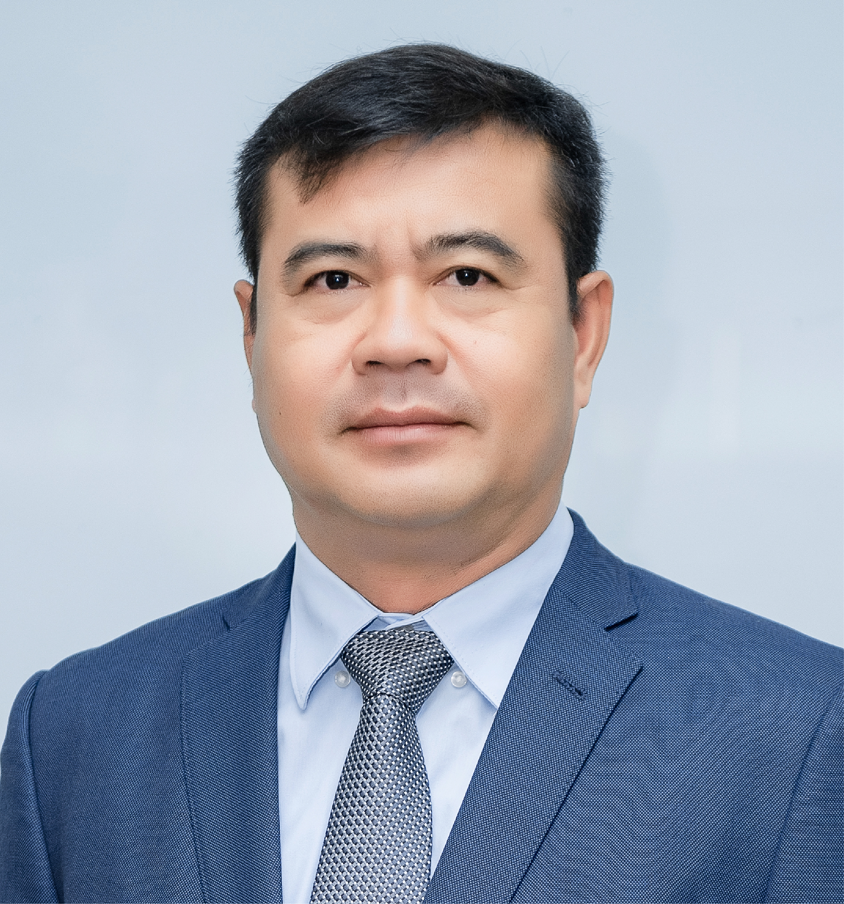</div><div class="speaker-info"><h3>H.E. Dr. Kao Thach</h3><div class="speaker-aff">ARDB, Cambodia</div><div class="speaker-role">Opening and welcome remarks (Day 2)</div><p class="bio-teaser">His Excellency Dr. KAO Thach, Delegate of Royal Government of Cambodia in charge as Chief Executive Officer and a member of the Board of Directors of ARDB.</p><button type="button" class="bio-btn" data-bio="kao-thach">Read full biography <span aria-hidden="true">→</span></button></div></article>
<article class="speaker-card" id="un-kheang"><div class="speaker-photo">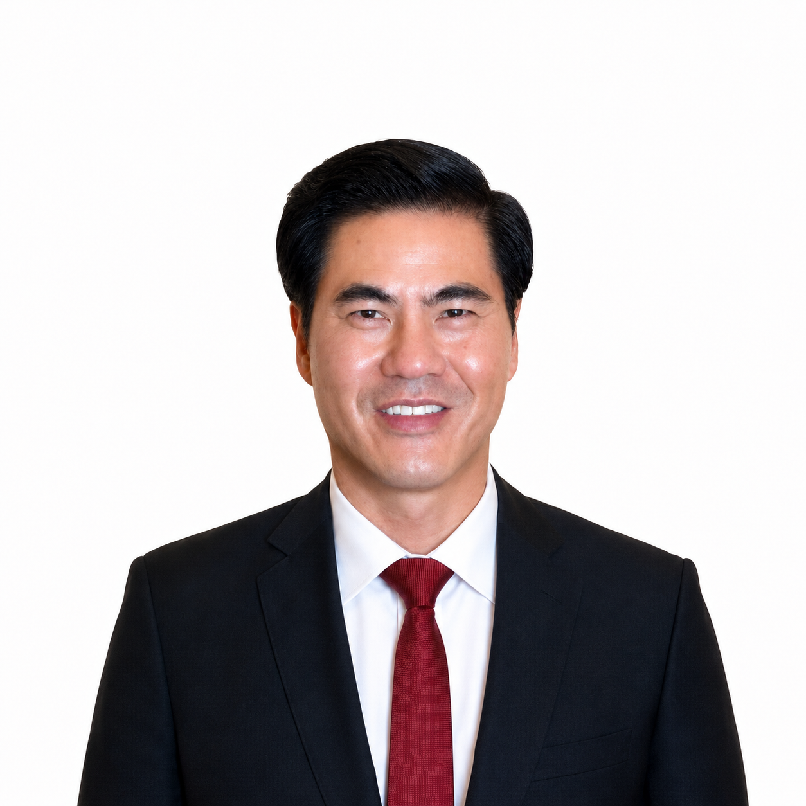</div><div class="speaker-info"><h3>H.E. Dr. UN Kheang</h3><div class="speaker-aff">Chairman of the Board of Directors of APM Center</div><p class="bio-teaser">Dr. Un Kheang is a distinguished Cambodian diplomat, scholar, and public policy expert. He currently serves as Secretary of State at the Ministry of Foreign Affairs and International Cooperation of the Kingdom of Cambodia. He is also Chairman of the Board of Directors of the Akkak Pundit Sapheachar AUN Pornmoniroth Center for Public Policy Studies and Training and a Board Member of the Cambodia Development Center.</p><button type="button" class="bio-btn" data-bio="un-kheang">Read full biography <span aria-hidden="true">→</span></button></div></article>
<article class="speaker-card" id="soeng-reth"><div class="speaker-photo">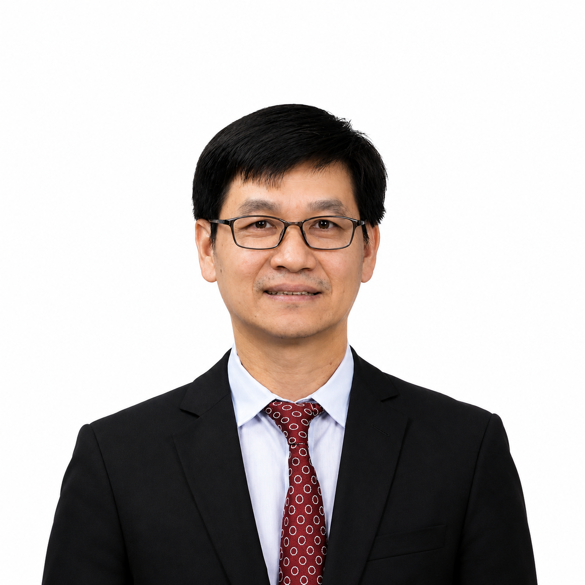</div><div class="speaker-info"><h3>H.E. Dr. Soeng Reth </h3><div class="speaker-aff">Ministry of Economy and Finance, Cambodia</div><div class="speaker-role">Moderator, Panel Discussion B (Day 3)</div><p class="bio-teaser">Dr. SOENG Reth is currently advisor to Samdech Moha Borvor Thipadei HUN MANET, Prime Minister of the Kingdom of Cambodia; Undersecretary of State for Ministry of Economy and Finance; and a member of the Supreme National Economic Council of Cambodia (SNEC). He was Advisor to Samdech Akka Moha Sena Padei Techo HUN SEN, former Prime Minister of the Kingdom of Cambodia. Dr. Reth Soeng was the Fulbright scholar-in-residence (Professor of Economics), under the Fulbright Lecturing Program of the U.S Department of State, in Massachusetts, U.S.A, for one academic year 2016-2017. During his Fulbright program, Dr. Soeng was frequent guest professor at the D’Amore-McKim School of Business, Northeastern University, Boston, Massachusetts, U.S.A. Dr. Soeng has been lead professor of economics at the Royal School of Administration and at Department of International Studies, Royal University of Phnom Penh. He served as a jury member for Master thesis defenses at the University of Antwerp, Belgium, and a doctoral examination member for doctoral thesis defenses in Cambodia. He has been a Research Fellow at the Centre for ASEAN Studies, University of Antwerp, Belgium since 2009 to the present. From February 2009 to January 2011, Dr. Soeng was selected to do his postdoctoral work at the Flemish Centre for International Policy, University of Antwerp, where he carried out a joint research project on the effects of globalization on labor market in Belgium, in collaboration with the National Bank of Belgium. His research work has been published in peer-reviewed scholarly journals, such as Journal of International Trade and Economic Development; Journal of Asian Economics; International Journal of Manpower; Journal of International Trade Law and Policy; and International Trade Journal); an international consultant to Economic Research Institute for ASEAN and East Asia (ERIA) based in Jakarta, Indonesia. His work is also published in two edited books by Edward Elgar in 2009, by Routledge in 2019 and ERIA in 2024. He gave lectures in economics, applied statistics, and applied econometrics at several other universities in Cambodia where he taught courses in undergraduate, graduate and doctoral programs. Dr. Soeng is also affiliated with the Faculty of Business and Economics, University of Antwerp, Belgium. Dr. Reth Soeng is appointed by sub-decree as a reserve member of the Royal Academy of Cambodia.</p><button type="button" class="bio-btn" data-bio="soeng-reth">Read full biography <span aria-hidden="true">→</span></button></div></article>
<article class="speaker-card" id="ratha-chiv"><div class="speaker-photo">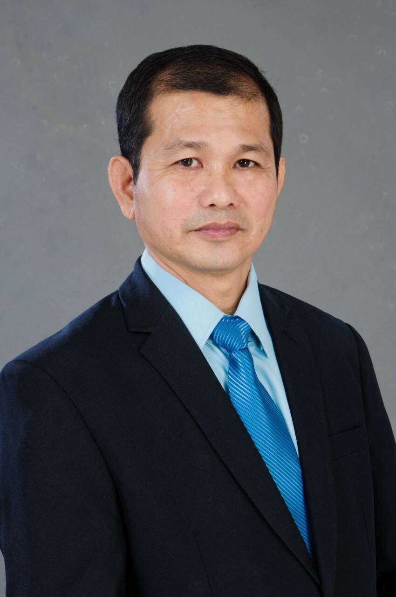</div><div class="speaker-info"><h3>Ratha Chiv</h3><div class="speaker-aff">Executive Vice Chancellor, Paññāsāstra University of Cambodia (PUC), Siem Reap Campus, Cambodia</div><div class="speaker-role">Opening and welcome remarks (Day 2)</div><p class="bio-teaser">Dr. Chiv Ratha, an Executive Vice Chancellor &amp; PUCSR Board Member, is an experienced leader with a strong background in both the public and private sectors. He has served in various significant roles, including Deputy Secretary-General of the Cambodia National Youth Council and Deputy Director General of Youth at the Ministry of Education, Youth, and Sports. With over two decades of expertise in youth development, strategic</p><button type="button" class="bio-btn" data-bio="ratha-chiv">Read full biography <span aria-hidden="true">→</span></button></div></article>
<article class="speaker-card" id="matthew-mccartney"><div class="speaker-photo">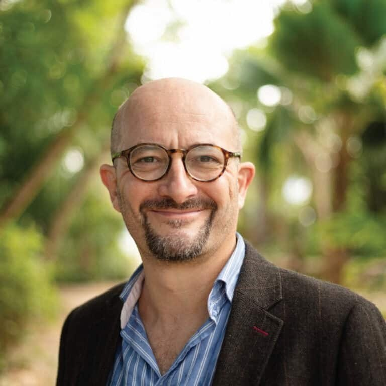</div><div class="speaker-info"><h3>Matthew McCartney</h3><div class="speaker-aff">Cambodia Development Resource Institute, Cambodia</div><div class="speaker-role">Special Lecture (Day 2); Panel Discussion A (Day 2)</div><p class="bio-teaser">Professor Dr Matthew McCartney is the Chief Economist at the Cambodia Development Resouece Institute (CDRI). He brings over 25 years of experience as an international development advisor (World Bank, USAid. EU. UNDP), a Professor at SOAS, the University of Oxford, and the Africa Urban Lab (AUL) in Zanzibar, and as a researcher who has interacted with partners in UK and global south Universities, think tanks, donors, grant-funders, NGOs, and government. Matthew has conducted development consultancy work in Bangladesh, Azerbaijan, Zambia, Botswana, Bosnia and Herzegovina, Georgia, Saudi Arabia, and Jordan; and has been a visiting Professor at Universities in Pakistan, India, Japan, South Korea, Poland, Zambia, and Belgium. Matthew is an economist specializing in issues of economic development, economic growth, special economic zones (SEZs), big infrastructure, urbanization, the resource curse, technology, industrialization and the role of the state, with a particular focus on the South Asian region (especially India, Sri Lanka, Bangladesh, and Pakistan), Africa (Tanzania, Zambia, and Ethiopia), the economics of the Chinese Belt and Road Initiative (BRI), and human development issues relating to nutrition, employment, education, poverty, and inequality. Matthew has published eight books (Cambridge University Press, Oxford University Press, Palgrave, and Routledge) fifteen peer-review journal articles and fifteen book chapters. His next book is focused on industrialization and the impact of China in Ethiopia and Zambia. Industrialisation, China, and the Developmental State: A Comparative Study of Governance in Ethiopia and Zambia, 2000-2020 and will be published by Routledge in 2026. Matthew holds a BSc (Economics) from the University of Cambridge, an MPhil (Economics) from the University of Oxford, and a PhD (Economics) from the School of Oriental and African Studies (SOAS), University of London.</p><button type="button" class="bio-btn" data-bio="matthew-mccartney">Read full biography <span aria-hidden="true">→</span></button></div></article>
<article class="speaker-card" id="michael-hill"><div class="speaker-photo">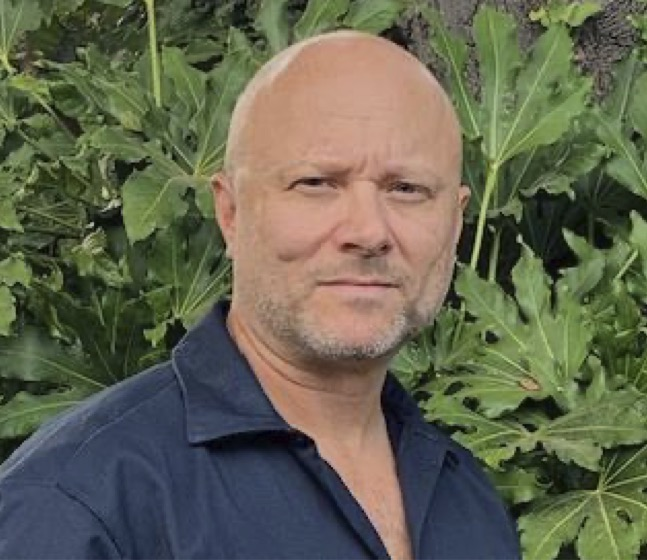</div><div class="speaker-info"><h3>Michael Hill</h3><div class="speaker-aff">University at Albany, SUNY, United States</div><div class="speaker-role">Panel Discussion B (Day 3)</div><p class="bio-teaser">Mike Hill is Professor of English at the University at Albany, State University of New York. He writes on and teaches realism and science fiction, the philosophy of science, environmental humanities, the history of English as a discipline, and most recently, the intersection of culture and war. His books are: On Posthuman War: Computation and Military Violence (Minnesota: 2022); The Other Adam Smith (Stanford: 2015) (co-authored with Warren Montag); After Whiteness: Unmaking an American Majority (NYU: 2004); Masses, Classes, and the Public Sphere (Verso: 2000) (contributing ed.); and Whiteness: A Critical Reader (NYU: 1997); (contrib. ed.). He is currently working on the issue of war and climate change, as well as a book on science and the early-modern novel.</p><button type="button" class="bio-btn" data-bio="michael-hill">Read full biography <span aria-hidden="true">→</span></button></div></article>
<article class="speaker-card" id="sothea-oum"><div class="speaker-photo">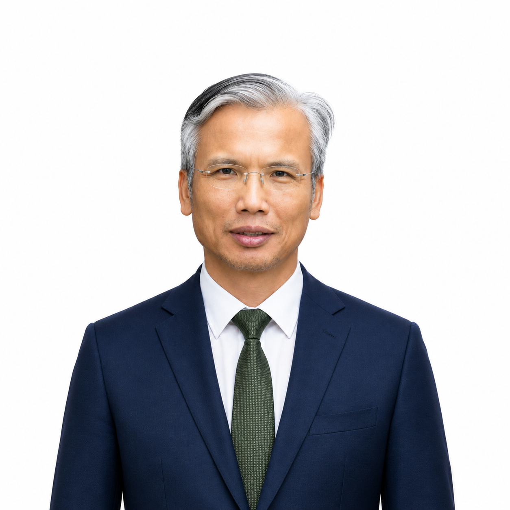</div><div class="speaker-info"><h3>Sothea Oum</h3><div class="speaker-aff">Member of the Board of Directors of APM Center</div></div></article>
<article class="speaker-card" id="sovannroeun-samreth"><div class="speaker-photo">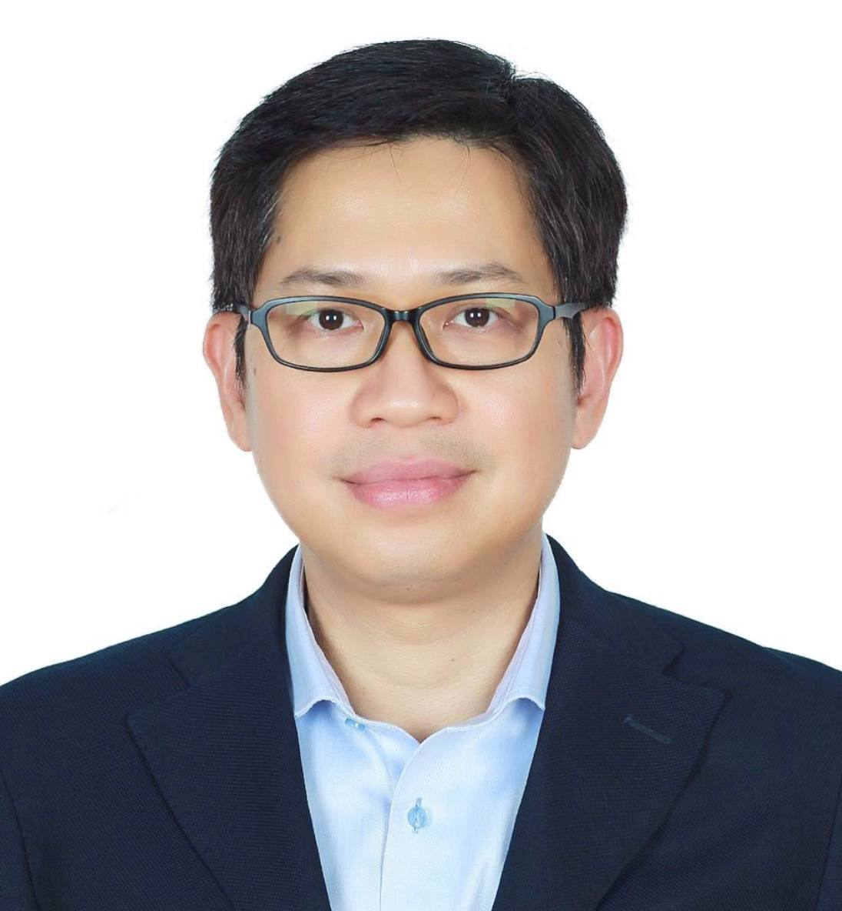</div><div class="speaker-info"><h3>Sovannroeun Samreth</h3><div class="speaker-aff">Saitama University, Japan</div><div class="speaker-role">Panel Discussion B (Day 3)</div></div></article>
<article class="speaker-card" id="thirunaukarasu-subramaniam"><div class="speaker-photo">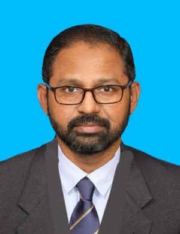</div><div class="speaker-info"><h3>Thirunaukarasu Subramaniam</h3><div class="speaker-aff">University of Malaya, Malaysia</div><div class="speaker-role">Panel Discussion B (Day 3)</div></div></article>
<article class="speaker-card" id="penghuy-ngov"><div class="speaker-photo">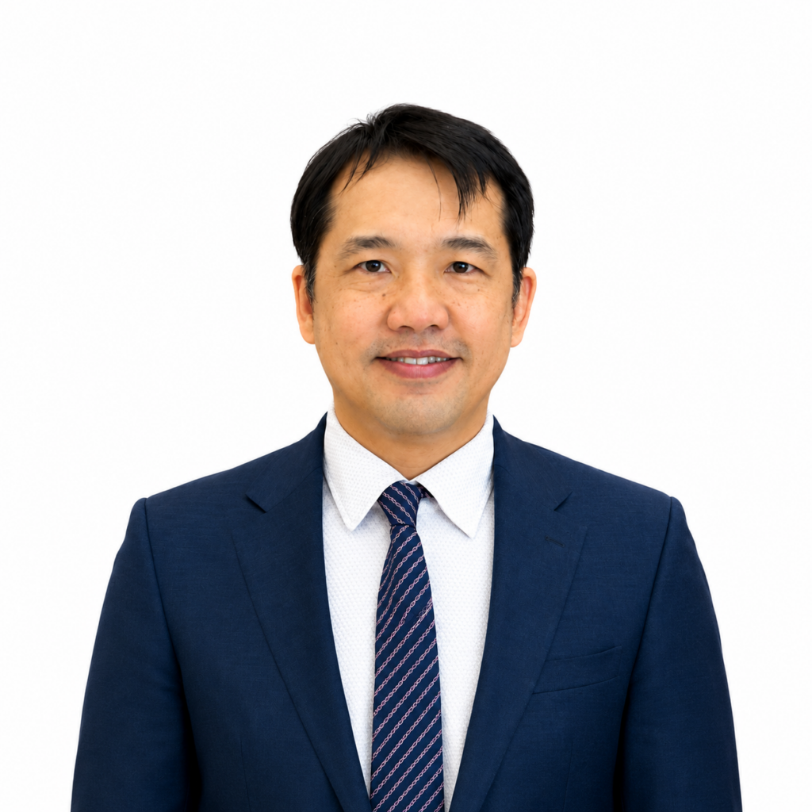</div><div class="speaker-info"><h3>Penghuy Ngov</h3><div class="speaker-aff">Royal University of Phnom Penh, Cambodia</div><div class="speaker-role">Moderator, Panel Discussion A (Day 2)</div></div></article>
<article class="speaker-card" id="sereyvuth-ky"><div class="speaker-photo">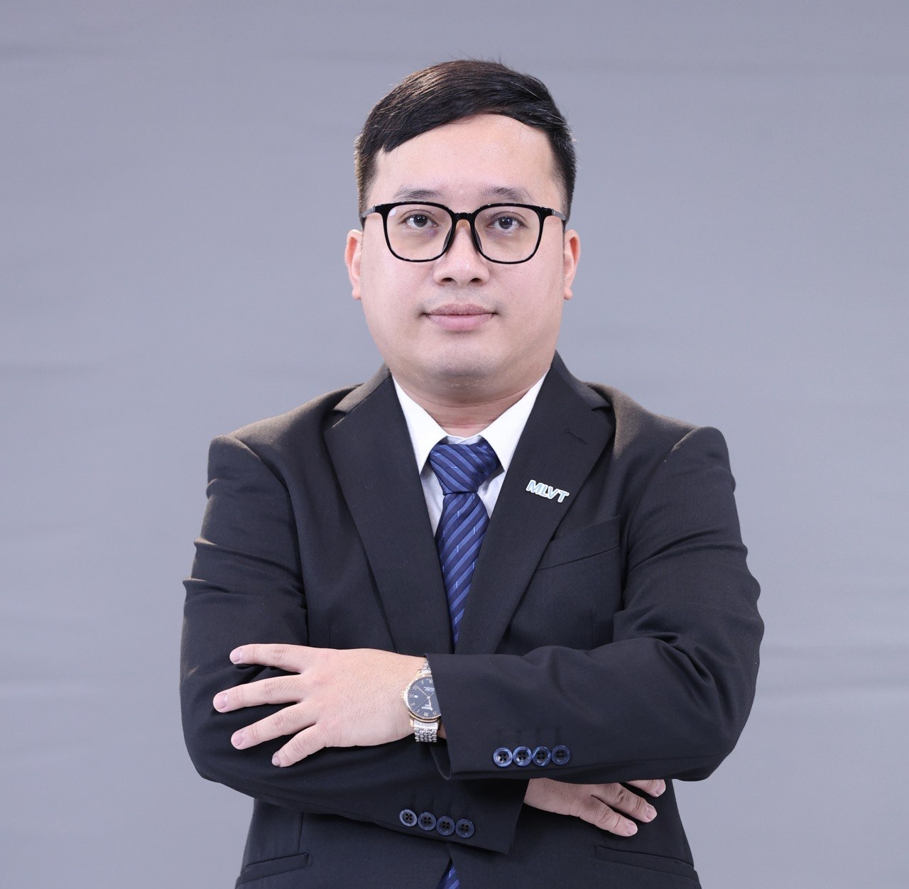</div><div class="speaker-info"><h3>Sereyvuth Ky</h3><div class="speaker-aff">Ministry of Labour and Vocational Training, Cambodia</div><div class="speaker-role">Panel Discussion A (Day 2)</div></div></article>
<article class="speaker-card" id="rido-thath"><div class="speaker-photo">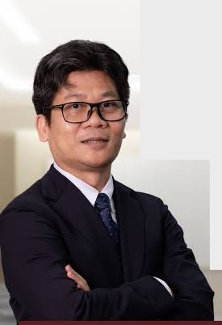</div><div class="speaker-info"><h3>Rido Thath</h3><div class="speaker-aff">Royal University of Phnom Penh, Cambodia</div><div class="speaker-role">Panel Discussion A (Day 2)</div></div></article>
<article class="speaker-card" id="dalin-ly"><div class="speaker-photo"></div><div class="speaker-info"><h3>Dalin Ly</h3><div class="speaker-aff">Member of the Board of Directors of APM Center</div></div></article>
</div>
<dialog class="bio-dialog" id="bio-kao-thach" aria-label="Biography of H.E. Dr. Kao Thach"><form method="dialog"><button class="bio-close" aria-label="Close">×</button></form><div class="bio-head"><div class="bio-avatar"></div><div><h3>H.E. Dr. Kao Thach</h3><div class="bio-aff">ARDB, Cambodia</div><div class="speaker-role">Opening and welcome remarks (Day 2)</div></div></div><div class="bio-body"><p>His Excellency Dr. KAO Thach, Delegate of Royal Government of Cambodia in charge as Chief Executive Officer and a member of the Board of Directors of ARDB.</p><p>In addition to his current duties, he is a member of the Supreme National Economic Council, with equivalent rank to the Secretary of State, and an arbitrator of the Arbitration Council. Prior to joining ARDB, H.E was a Deputy Director General of the Securities and Exchange Commission of Cambodia with the equivalent rank as the Under-Secretary of State (in charge of the Department of Legal Affairs and the Intermediary Inspection Department), formerly the Chief of Office of the Financial Marketing at the Department of Financial Industry and Member of the Technical Working Group on Financial sector, representing the Ministry of Economy and Finance under the ASEAN Framework for Capital Market Development such as ABMI, ACMF and Financial Services Liberalization.</p><p>H.E has been involved in drafting the Law on Public Securities and the Law on the Issuance and Trading of Non-government Securities, as well as being a member of the working group in charge of preparing the financial sector development strategy from 2006 to 2015 and 2011 to 2020. From 1999 to 2003 he was a legal officer at the Ministry of Justice and a clerk in Koh Kong province.</p><p>For his academic background, H.E received his PhD in Public Policy from the University of Cambodia (Cambodia) in 2021, completed the dissertation in “The Role of Securities Regulators in Efficient Supervision and Regulation of the Securities Market in Cambodia” and his PhD in Administration. Business (DBA) from EU Business School (Switzerland) in 2018.</p><p>H.E obtained a master’s degree in Law from Bond University (Australia) in 2002, majoring in International Trade Law System, WTO Legal Framework, Dispute Resolution, and Dispute Design System and a Bachelor of Laws from Royal University of Law and Economics (LLB) in 1998.</p></div></dialog>
<dialog class="bio-dialog" id="bio-un-kheang" aria-label="Biography of H.E. Dr. UN Kheang"><form method="dialog"><button class="bio-close" aria-label="Close">×</button></form><div class="bio-head"><div class="bio-avatar"></div><div><h3>H.E. Dr. UN Kheang</h3><div class="bio-aff">Chairman of the Board of Directors of APM Center</div></div></div><div class="bio-body"><p>Dr. Un Kheang is a distinguished Cambodian diplomat, scholar, and public policy expert. He currently serves as Secretary of State at the Ministry of Foreign Affairs and International Cooperation of the Kingdom of Cambodia. He is also Chairman of the Board of Directors of the Akkak Pundit Sapheachar AUN Pornmoniroth Center for Public Policy Studies and Training and a Board Member of the Cambodia Development Center.</p><p>Before joining the Ministry of Foreign Affairs and International Cooperation in 2023, Dr. Un was an award-winning Professor of Political Science at Northern Illinois University (NIU) in the United States and a Chair Professor at the School of International Relations and Southeast Asian Studies at Xiamen University under China’s High-Level Foreign Talents Program.</p><p>Dr. Un, a widely respected scholar in political science, international relations, and Southeast Asian studies, has published extensively in leading international journals and academic presses. His scholarly achievements have earned him prestigious fellowships and research appointments, including those from the Canberra Fellowships Program (CFP), the Fulbright Program, the Royal Netherlands Institute of Southeast Asian and Caribbean Studies (KITLV), the Center for Khmer Studies, and the Center for Asian Democracy at the University of Louisville.</p><p>Internationally recognized for his expertise in Southeast Asia, diplomacy, and global affairs, Dr. Un has delivered lectures and participated in policy dialogues at leading universities, research institutes, think tanks, and international forums across Asia, Africa, Europe, and North America.</p></div></dialog>
<dialog class="bio-dialog" id="bio-soeng-reth" aria-label="Biography of H.E. Dr. Soeng Reth "><form method="dialog"><button class="bio-close" aria-label="Close">×</button></form><div class="bio-head"><div class="bio-avatar"></div><div><h3>H.E. Dr. Soeng Reth </h3><div class="bio-aff">Ministry of Economy and Finance, Cambodia</div><div class="speaker-role">Moderator, Panel Discussion B (Day 3)</div></div></div><div class="bio-body"><p>Dr. SOENG Reth is currently advisor to Samdech Moha Borvor Thipadei HUN MANET, Prime Minister of the Kingdom of Cambodia; Undersecretary of State for Ministry of Economy and Finance; and a member of the Supreme National Economic Council of Cambodia (SNEC). He was Advisor to Samdech Akka Moha Sena Padei Techo HUN SEN, former Prime Minister of the Kingdom of Cambodia. Dr. Reth Soeng was the Fulbright scholar-in-residence (Professor of Economics), under the Fulbright Lecturing Program of the U.S Department of State, in Massachusetts, U.S.A, for one academic year 2016-2017. During his Fulbright program, Dr. Soeng was frequent guest professor at the D’Amore-McKim School of Business, Northeastern University, Boston, Massachusetts, U.S.A. Dr. Soeng has been lead professor of economics at the Royal School of Administration and at Department of International Studies, Royal University of Phnom Penh. He served as a jury member for Master thesis defenses at the University of Antwerp, Belgium, and a doctoral examination member for doctoral thesis defenses in Cambodia. He has been a Research Fellow at the Centre for ASEAN Studies, University of Antwerp, Belgium since 2009 to the present. From February 2009 to January 2011, Dr. Soeng was selected to do his postdoctoral work at the Flemish Centre for International Policy, University of Antwerp, where he carried out a joint research project on the effects of globalization on labor market in Belgium, in collaboration with the National Bank of Belgium. His research work has been published in peer-reviewed scholarly journals, such as Journal of International Trade and Economic Development; Journal of Asian Economics; International Journal of Manpower; Journal of International Trade Law and Policy; and International Trade Journal); an international consultant to Economic Research Institute for ASEAN and East Asia (ERIA) based in Jakarta, Indonesia. His work is also published in two edited books by Edward Elgar in 2009, by Routledge in 2019 and ERIA in 2024. He gave lectures in economics, applied statistics, and applied econometrics at several other universities in Cambodia where he taught courses in undergraduate, graduate and doctoral programs. Dr. Soeng is also affiliated with the Faculty of Business and Economics, University of Antwerp, Belgium. Dr. Reth Soeng is appointed by sub-decree as a reserve member of the Royal Academy of Cambodia.</p><p>Dr. SOENG Reth was born in 1973 to a poor, rice-farming family in Kirivong district, Takeo province. He stayed in a Buddhist monastery (Stung Meanchey pagoda) with Buddhist monks during his undergraduate work in mathematics at the Royal University of Phnom Penh. Dr. Soeng holds B.S. in Mathematics, MBA with concentration in Finance, and PhD in Applied Economics (Belgium) on 13 February 2009 from the University of Antwerp, under the Royal Government of Belgium’s Scholarship Program.</p></div></dialog>
<dialog class="bio-dialog" id="bio-ratha-chiv" aria-label="Biography of Ratha Chiv"><form method="dialog"><button class="bio-close" aria-label="Close">×</button></form><div class="bio-head"><div class="bio-avatar"></div><div><h3>Ratha Chiv</h3><div class="bio-aff">Executive Vice Chancellor, Paññāsāstra University of Cambodia (PUC), Siem Reap Campus, Cambodia</div><div class="speaker-role">Opening and welcome remarks (Day 2)</div></div></div><div class="bio-body"><p>Dr. Chiv Ratha, an Executive Vice Chancellor &amp; PUCSR Board Member, is an experienced leader with a strong background in both the public and private sectors. He has served in various significant roles, including Deputy Secretary-General of the Cambodia National Youth Council and Deputy Director General of Youth at the Ministry of Education, Youth, and Sports. With over two decades of expertise in youth development, strategic</p><p>leadership, policy development, and legislative drafting, Dr. Chiv has played a vital role in shaping national programs and policies.Additionally, he has a solid academic background, having served as Dean of the Faculty of Tourism and Hospitality Management and the Faculty of Business Administration at Pannasastra University of Cambodia. He holds a Ph.D. in Leadership, an MBA from Monash University, and a Bachelor of Pharmacy. Dr. Chiv is also actively involved in part-time lecturing and has diverse skills in leadership, education, event planning, customer service, and stakeholder collaboration.</p></div></dialog>
<dialog class="bio-dialog" id="bio-matthew-mccartney" aria-label="Biography of Matthew McCartney"><form method="dialog"><button class="bio-close" aria-label="Close">×</button></form><div class="bio-head"><div class="bio-avatar"></div><div><h3>Matthew McCartney</h3><div class="bio-aff">Cambodia Development Resource Institute, Cambodia</div><div class="speaker-role">Special Lecture (Day 2); Panel Discussion A (Day 2)</div></div></div><div class="bio-body"><p>Professor Dr Matthew McCartney is the Chief Economist at the Cambodia Development Resouece Institute (CDRI). He brings over 25 years of experience as an international development advisor (World Bank, USAid. EU. UNDP), a Professor at SOAS, the University of Oxford, and the Africa Urban Lab (AUL) in Zanzibar, and as a researcher who has interacted with partners in UK and global south Universities, think tanks, donors, grant-funders, NGOs, and government. Matthew has conducted development consultancy work in Bangladesh, Azerbaijan, Zambia, Botswana, Bosnia and Herzegovina, Georgia, Saudi Arabia, and Jordan; and has been a visiting Professor at Universities in Pakistan, India, Japan, South Korea, Poland, Zambia, and Belgium. Matthew is an economist specializing in issues of economic development, economic growth, special economic zones (SEZs), big infrastructure, urbanization, the resource curse, technology, industrialization and the role of the state, with a particular focus on the South Asian region (especially India, Sri Lanka, Bangladesh, and Pakistan), Africa (Tanzania, Zambia, and Ethiopia), the economics of the Chinese Belt and Road Initiative (BRI), and human development issues relating to nutrition, employment, education, poverty, and inequality. Matthew has published eight books (Cambridge University Press, Oxford University Press, Palgrave, and Routledge) fifteen peer-review journal articles and fifteen book chapters. His next book is focused on industrialization and the impact of China in Ethiopia and Zambia. Industrialisation, China, and the Developmental State: A Comparative Study of Governance in Ethiopia and Zambia, 2000-2020 and will be published by Routledge in 2026. Matthew holds a BSc (Economics) from the University of Cambridge, an MPhil (Economics) from the University of Oxford, and a PhD (Economics) from the School of Oriental and African Studies (SOAS), University of London.</p></div></dialog>
<dialog class="bio-dialog" id="bio-michael-hill" aria-label="Biography of Michael Hill"><form method="dialog"><button class="bio-close" aria-label="Close">×</button></form><div class="bio-head"><div class="bio-avatar"></div><div><h3>Michael Hill</h3><div class="bio-aff">University at Albany, SUNY, United States</div><div class="speaker-role">Panel Discussion B (Day 3)</div></div></div><div class="bio-body"><p>Mike Hill is Professor of English at the University at Albany, State University of New York. He writes on and teaches realism and science fiction, the philosophy of science, environmental humanities, the history of English as a discipline, and most recently, the intersection of culture and war. His books are: On Posthuman War: Computation and Military Violence (Minnesota: 2022); The Other Adam Smith (Stanford: 2015) (co-authored with Warren Montag); After Whiteness: Unmaking an American Majority (NYU: 2004); Masses, Classes, and the Public Sphere (Verso: 2000) (contributing ed.); and Whiteness: A Critical Reader (NYU: 1997); (contrib. ed.). He is currently working on the issue of war and climate change, as well as a book on science and the early-modern novel.</p></div></dialog>
<script>
(function(){
  var root=document.documentElement;
  document.addEventListener('click',function(e){
    var b=e.target.closest('[data-bio]');
    if(b){var d=document.getElementById('bio-'+b.getAttribute('data-bio'));
      if(d&&d.showModal){var cs=getComputedStyle(document.body);d.style.background=cs.backgroundColor;d.style.color=cs.color;root.style.overflow='hidden';d.showModal();}return;}
    if(e.target.matches&&e.target.matches('dialog.bio-dialog'))e.target.close();
  });
  document.addEventListener('close',function(e){if(e.target.matches&&e.target.matches('dialog.bio-dialog'))root.style.overflow='';},true);
})();
</script>
```

[View the conference program →](program.qmd)
